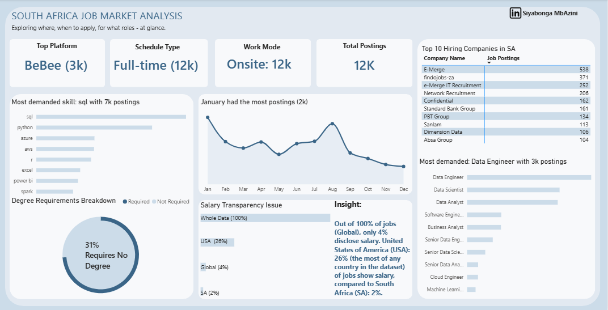
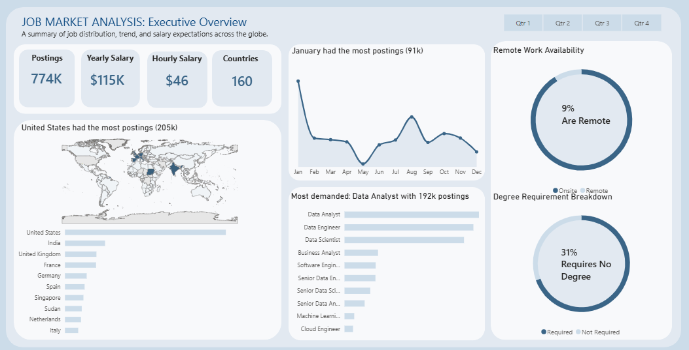
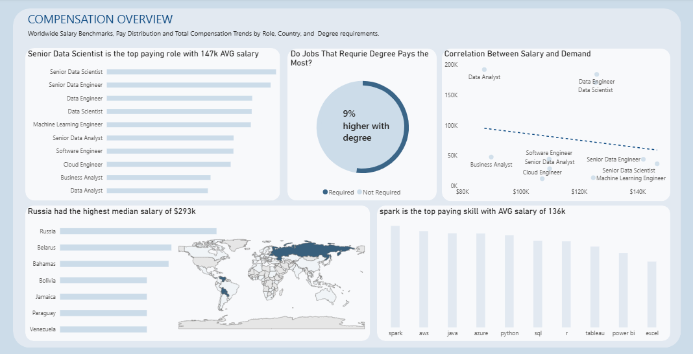

# SOUTH AFRICA TECH MARKET ANALYSIS


## INTRODUCTION

**Am I wasting time learning data analysis?**
That is the question I kept asking when I started transitioning  from humanities to tech. If you are switching careers too, you might feel the same.  so i pulle `12` South African data job postings alongside a global benchmark dataset of `700k` Job Postings collected in `2023`, to understand:
- Which data roles are in demand?
- which skills are in demand?
- whether degrees are commonly required?
- whether remote work is commonly available?
- Job postings trends by month?
- which job platforms carry the most opportunities?
- which companies hire the most
- compensation and salary transparency

## Pulling And Data Cleaning process
### 1. SQL Script: Data  Extraction & Basic  Cleaning

```sql
---Create a flat table of job postings facts and company dimension
CREATE TABLE job_postings_final AS
SELECT
jpc.job_id,
jpc.company_id,
job_title_short,
job_location,
job_via,
job_schedule_type,
job_work_from_home,
job_posted_date,
job_no_degree_mention,
job_health_insurance,
job_country,
salary_rate,
salary_year_avg,
salary_hour_avg,
month_num,
month_name,
salary_adj,
name
FROM job_postings_cleaned AS jpc ---use inner join to join on what exists in both tables
INNER JOIN company_dim_cleaned AS cdc ON jpc.company_id= cdc.company_id;

---create a table of skills
CREATE TABLE job_skills_final AS
SELECT
job_id,
skills as skill
FROM skills_job_dim AS sjd ---further use inner join
INNER JOIN skills_dim AS sd ON sjd.skill_id=sd.skill_id;

---create a new dim table of schedule type
CREATE TABLE schedule_type_final AS
SELECT*
FROM schedule_type_dim;
```

### 2. Python: Advance Cleaning & Normalization
```python

#Basic imports
import pandas as pd
import numpy as np
import datetime as dt

#=========================================================================================
#DATA CLEANING PROCESS
#=========================================================================================

#Read CSV's from the local storage using pandas
job_postings_fact= pd.read_csv("C:/temp/job_postings_fact.csv")
company_dim= pd.read_csv("C:/temp/company_dim.csv")
skills_job_dim= pd.read_csv("C:/temp/skills_job_dim.csv")
skills_dim= pd.read_csv("C:/temp/skills_dim.csv")

#functions to organize data cleaning into one place and make it reusable

def clean_fact(df):
    #Change data types from string object into a datetime object
    df['job_posted_date']= pd.to_datetime(df['job_posted_date'])
    #Remove leading "via" and white space ahead of platforms
    df['job_via']= df['job_via'].str.strip().str.replace('via', "")
    #Create new columns, month numbers and month names
    df['month_num']= df['job_posted_date'].dt.month
    df['month_name']= df['job_posted_date'].dt.strftime("%B")
    #created a column of adjusted salary, where nulls are filled with the alternative hourly salary, when not null *2080
    df['salary_adj']= np.where(df['salary_year_avg'].notna(), df['salary_year_avg'],
    np.where(df['salary_year_avg'].isna() & df['salary_hour_avg'].notna(),
     df['salary_hour_avg']*2080,np.nan))
    #Removed null values on specified columns and unneeded columns
    df= df.dropna(subset=['job_location','job_via','job_schedule_type','job_country',])
    df= df.drop(columns= ['job_title','search_location'])
    return(df)

def clean_company(df):
    #Drop unneeded columns
    df= df.drop(columns=[ 'link','link_google','thumbnail'])
    return(df)

def clean_schedule_type(df):
    #Handling data types
    df['job_schedule_type']= df['job_schedule_type'].astype(str)
    #Used regular expressions to find and replace objects
    df['job_schedule_type']= df['job_schedule_type'].str.replace(r"[\[\]'\"']" , "", regex= True)
    df['job_schedule_type']= df['job_schedule_type'].str.replace(r"\s+and\s+", ",", regex= True, case= False)
    #splitted on the specified charecter and exploded it into charecters occupying it own space
    df['job_schedule_type']= df['job_schedule_type'].str.split(',')
    schedule_type= df[['job_id','company_id','job_schedule_type']].explode('job_schedule_type')
    return(schedule_type)


job_postings_fact= clean_fact(job_postings_fact)
schedule_type_dim=clean_schedule_type(job_postings_fact)
company_dim = clean_company(company_dim)
```

## DASHBOARD PREVIEW
*The project consisted of three pages, first showing global benchmark,then deep dive to South Africa Tech market.*
### Page 1: Global Overiview

### Page 2: Compensation Overview

### Page 3: South Africa Analysis


## What I found

## Key Metrics
- Top Platform  : `BeBee (3k)`
- Schedule Type : `Full-time (12k)`
- Work-mode     : `Onsite (12k)`
- Total Postings: `12k`

### 1. Most in Demand Roles

**finding:**
- Data Engineer had the highest demand `(3k)`
- Data scientist followed
- Data analyst ranked third

**Insight:**
Engineering-heavy roles appear to dominate the market, and the good thing, Data analyst ranked `top 3`, so entry points exist.

## comparison vs Global:

Globally it's reversed- Data Analyst `192k` is #1, Data Engineer is #2.
SA is 2-3 years behind- building infrastructure now (needs Engineers), global market is already using it (need Analysts). Target Engineer to be early, or Analyst to enter easily. 


### 2. Monthly Posting Trend

**Finding:**
- January had the highest activity
- postings generrally declined through the year
- August showed a brief spike

**insight:**

Hiring may follow seasonal cycles

## Comparison vs Global:

Global chart also sjows january peak at `91k` postings, then decline to May, August spike. SA follows global cycle exactly. Strategy: Apply in Deceberand July when hiring managers load jobs for Jan/Aug.

### 3. Companies That Hire the Most

**Finding:**
- In general, E-merge dominates
- Findojobs-za Follows
- e-merge IT Recruitment trails significantly

**Insight:**

3 of top 4 are agencies. In SA, you must optimize for agncy ATS keywords - SQL, Full-time, Onsite, Data Engineer.

### 4. Degree Requirements

**Finding:**
- `31%` job postings did not require a degree, when we did not account for job type.

**Insight:**

Formal education still appears important in this market, especially on roles like Data Scientist, Senior Data Scientist, and Machine Learning, where over `80%` of the total job postings required a degree. For the remainder, over `30%` of job postings did not mention a degree, signalling you don't need a CS degree for everything. Some campanies hire based on skills and experience alone.

### 5. Most demanded skills?

**Finding:**
- SQL was the most demanded skills `(7k)`.
- Python followed.
- Azure trailed third.

**Insight:**
 For SA, SQL is non-negotiable. `7k` of the `12` require it.

### 6. Salary Transparency(ST).

**Finding:**
- South Africa ST : `(2%)`.
- United States ST: `(26%)`.
- Global ST       : `(4%)`.

**Insight:**

Not only South African companies do not show salary, `4%` of the data fields in the entire dataset had salary shown, compared to `26%` of the USA data (being the highest, which is still low relative to the size of the dataset), signaling a global salary transparency issue.

*NB: this is the main reason i did not focus compensation analysis on South Africa and included global compensation over view for broader picture about salary expectations*
## Key Takeaways

For aspiring data professionals in South Africa:
1. Focus on Data Engineering, Data Science, and Data Analysts skills.
2. Look for job opportunities as early as January, as they decline over the year.
3. Prioritize direct job search in agencies like E-merge.
4. Consider degree requirements when planning career entry, or just earn one, though there's still opportunities for non-degree holders.
5. Ensure proficiency in skills like SQL.

## Tech Stack

- **SQL- Basic Cleaning**
- **Python- Advance Cleaning**
- **Power BI- Data Visualization**

## Conclusion

This project analyzed job postings in South African data job market to uncover patterns in skills demand and role requiremnets. The findings highlight the most in-demand technical skills and provide insight into how employers structure job requirements accross different roles. These insights can help job seekers and those who are getting into technical and analytical roles to better align their skills with market demand and improve their chances of targeting relavant opportunities.